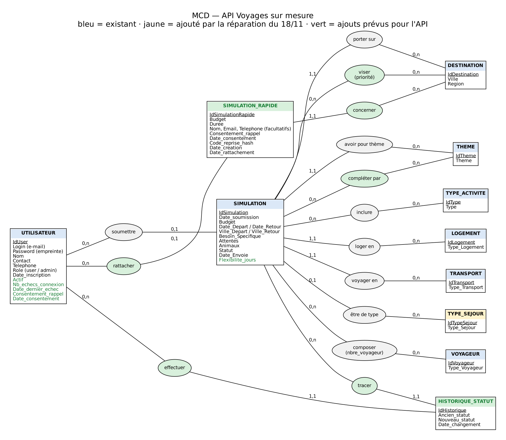
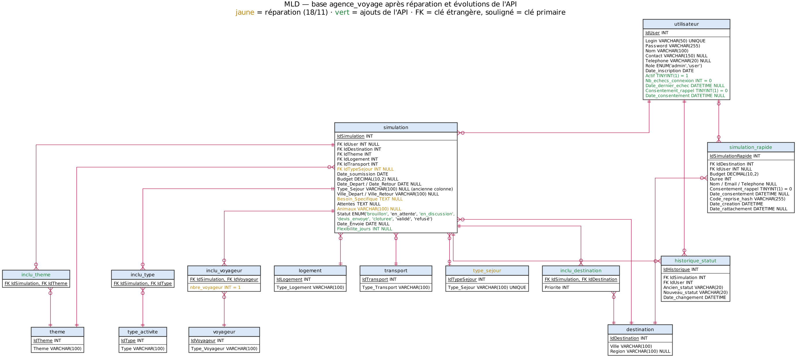
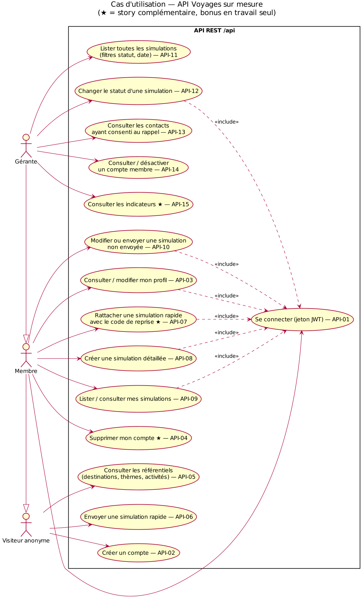
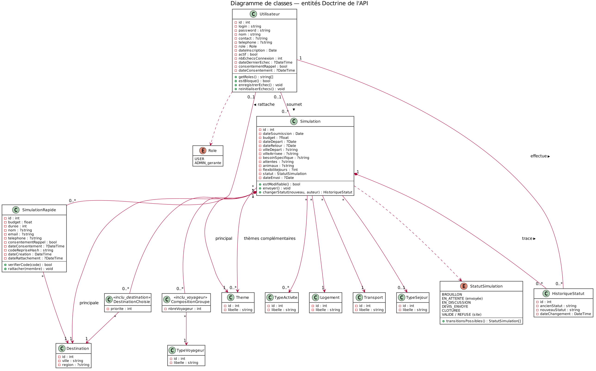
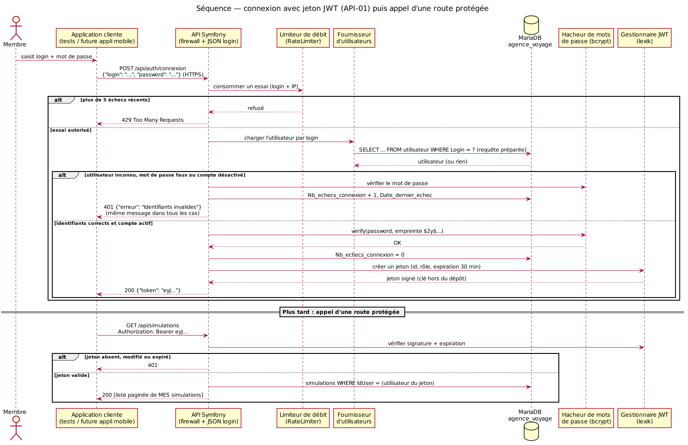
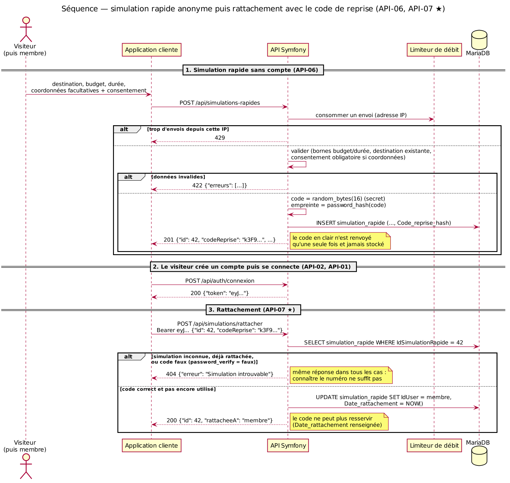
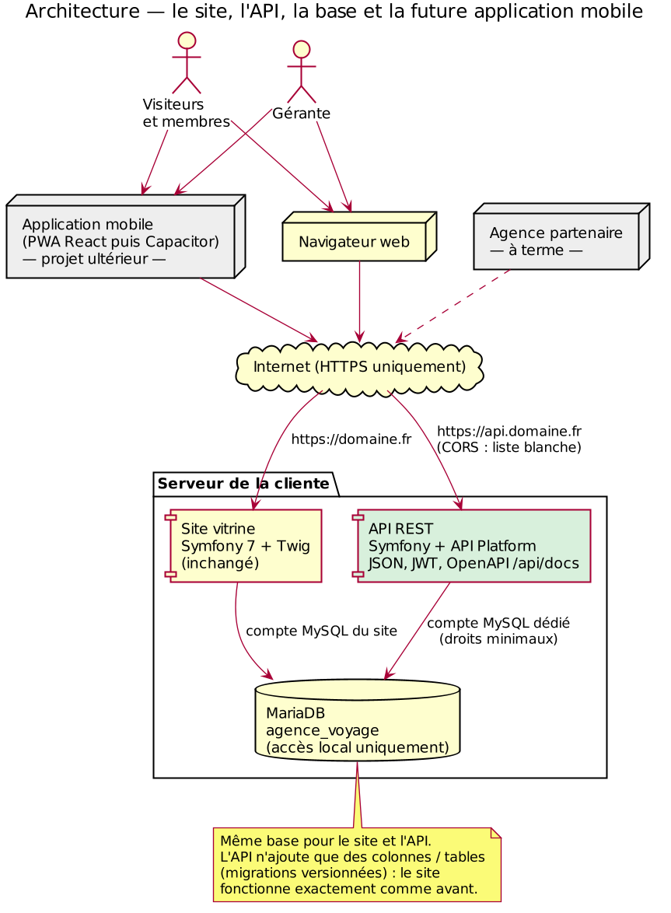
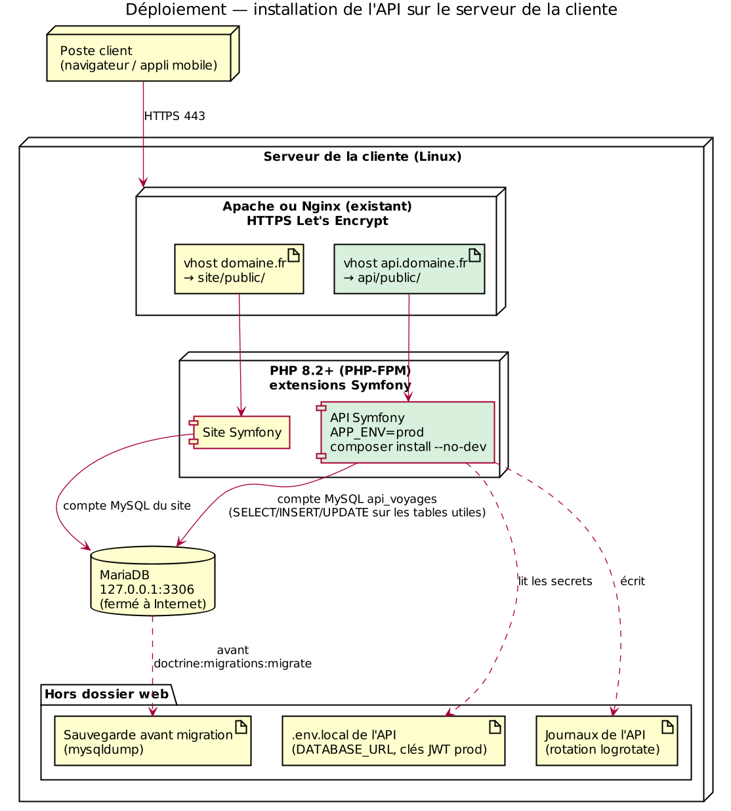

# Schémas de conception — API Voyages sur mesure

Schémas utilisés dans la fiche E6. Les sources (PlantUML / Graphviz) sont dans [`sources/`](sources/) : pour régénérer une image, `plantuml -tpng sources/XX.puml -o ..` ou `dot -Tpng sources/01-mcd.dot -o 01-mcd.png`.

Code couleur commun : **bleu** = existant dans la base du site · **jaune** = ajouté par la réparation du 18/11 · **vert** = ajouts prévus pour l'API.

---

## 1. MCD

Le MCD reprend la base réelle du site (et non le MLD théorique du cahier des charges), complétée par les ajouts de l'API. Un membre soumet 0 à n simulations, une simulation peut être anonyme (0,1) ; l'API ajoute la simulation rapide avec son code de reprise, les destinations par ordre de priorité, les thèmes complémentaires et l'historique des changements de statut.

## 2. MLD

Le MLD montre les tables, les types et les clés étrangères après les migrations. Toutes les évolutions sont des ajouts (colonnes avec valeur par défaut ou nouvelles tables) pour que le site continue de fonctionner ; seules exceptions : `Besoin_Specifique` passée en texte pour réparer le site, et l'ENUM `Statut` étendu avec les nouveaux statuts (les valeurs existantes sont conservées).

## 3. Cas d'utilisation

Trois acteurs se partagent l'API : le visiteur anonyme (référentiels, simulation rapide, création de compte), le membre qui hérite des droits du visiteur et gère ses propres simulations, et la gérante qui hérite des droits du membre et traite toutes les demandes. Toutes les actions du membre et de la gérante passent par la connexion avec jeton JWT.

## 4. Diagramme de classes

Les classes correspondent aux entités Doctrine de l'API, reliées aux tables existantes. Les règles métier sont portées par les entités elles-mêmes : `Simulation::estModifiable()` et `changerStatut()` (transitions autorisées + historique), `Utilisateur::estBloque()` (compte désactivé ou trop d'échecs), `SimulationRapide::verifierCode()` (code de reprise).

## 5. Séquence — connexion JWT

La connexion est freinée après 5 échecs (429) et renvoie toujours le même message d'erreur, pour ne pas révéler si le login existe. Le mot de passe est vérifié avec le même hachage que le site (bcrypt `$2y$`), puis l'API renvoie un jeton signé valable 30 minutes, vérifié à chaque appel d'une route protégée (401 s'il est absent, modifié ou expiré).

## 6. Séquence — simulation rapide et rattachement

Un visiteur envoie une simulation rapide sans compte (envois limités par adresse IP) ; l'API lui renvoie une seule fois un code de reprise secret, dont seule l'empreinte est stockée. Une fois connecté, il rattache la simulation à son compte avec ce code : connaître le numéro de la simulation ne suffit pas, et le code ne peut servir qu'une fois.

## 7. Architecture

Le site et l'API sont deux applications Symfony distinctes qui partagent la même base MariaDB, chacune avec son propre compte MySQL (droits minimaux pour l'API). L'API, servie sur `api.domaine.fr` en HTTPS avec une liste blanche CORS, prépare l'arrivée de l'application mobile et, à terme, d'une agence partenaire.

## 8. Déploiement

L'API s'installe sur le serveur existant sans nouveau logiciel : le serveur web sert son dossier `public/` sur un sous-domaine, avec le même PHP que le site. Les secrets (accès base, clés JWT de production) et les journaux sont rangés hors du dossier web, la base reste fermée à Internet, et une sauvegarde est faite avant chaque migration.

---

## Choix de conception à retenir

| Sujet | Choix | Pourquoi |
|---|---|---|
| Simulation rapide | Nouvelle table `simulation_rapide` | La table `simulation` impose destination, thème, logement et transport : une simulation anonyme n'y entre pas sans modifier des colonnes existantes |
| Code de reprise | Aléatoire (`random_bytes`), stocké haché | Comme un mot de passe : une fuite de la base ne permet pas de rattacher la simulation d'un autre |
| Statuts | ENUM étendu : `brouillon` → `en_attente` (= envoyée) → `en_discussion` → `devis_envoye` → `cloturee` ; `validé` / `refusé` conservés pour le site | Le site continue d'afficher et de modifier ses statuts ; l'API ajoute les siens sans rien renommer |
| Rôle gérante | Réutilise `utilisateur.Role = 'admin'` | Le rôle existe déjà en base (contrairement à ce que dit le cahier des charges) |
| Destinations multiples | Table `inclu_destination` (priorité) ; `simulation.IdDestination` = destination n°1 | Le site continue de lire sa destination principale |
| Besoins spécifiques | Texte, visible seulement par le membre propriétaire et la gérante | Peut contenir des données de santé (RGPD) |
