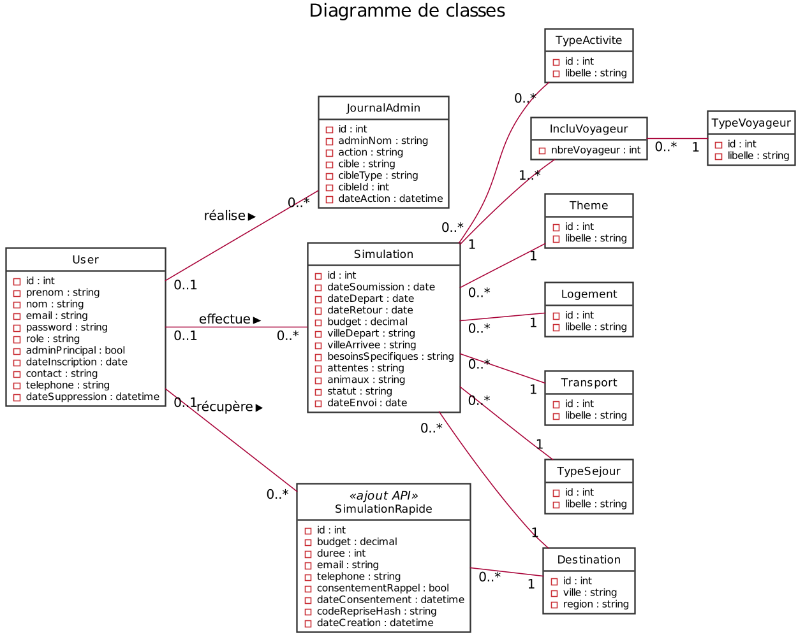
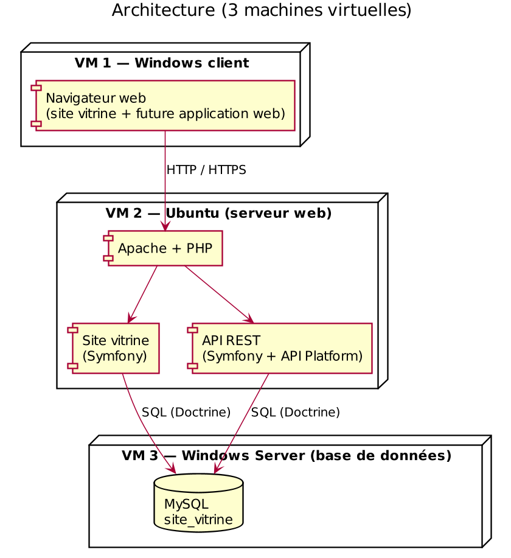

# Schémas de conception — API Voyages sur mesure

Ce sont les schémas de la fiche E6. Ils reprennent la base du site dans sa version du 19/11/2026 (cahier des charges du site **V03**) et la table que j'ajoute pour l'API (`simulation_rapide`).

Les sources sont dans [`sources/`](sources/). Pour régénérer une image : `dot -Tpng sources/01-mcd.dot -o 01-mcd.png` ou `plantuml -tpng sources/02-classes.puml`.

---

## 1. MCD

Un utilisateur peut faire plusieurs simulations. Une simulation a une destination, un thème, un logement, un transport et un type de séjour. Elle peut inclure plusieurs types d'activité et plusieurs catégories de voyageurs (avec leur nombre). Le journal_admin garde l'historique des actions des administrateurs.

**Ajout pour l'API : SIMULATION_RAPIDE.** Un visiteur fait une simulation rapide sans compte (destination, budget, durée, coordonnées facultatives). L'API lui renvoie un code secret, stocké seulement sous forme d'empreinte (`Code_reprise_hash`). Une fois inscrit, il récupère la simulation sur son compte avec ce code (`IdUser` est alors rempli).

## 2. MLD

En **gras** : clé primaire. `#` : clé étrangère.

- utilisateur (**IdUser**, Nom, Prenom, Login, Password, Contact, Telephone, Role, Admin_principal, Date_inscription, Date_suppression)
- simulation (**IdSimulation**, Date_soumission, Budget, Date_Depart, Date_Retour, Ville_Depart, Ville_Retour, Besoin_Specifique, Attentes, Animaux, Statut, Date_Envoie, #IdUser, #IdDestination, #IdTheme, #IdLogement, #IdTransport, #IdTypeSejour)
- destination (**IdDestination**, Ville, Region)
- theme (**IdTheme**, Theme)
- logement (**IdLogement**, Type_Logement)
- transport (**IdTransport**, Type_Transport)
- type_sejour (**IdTypeSejour**, Type_Sejour)
- type_activite (**IdType**, Type)
- voyageur (**IdVoyageur**, Type_Voyageur)
- inclu_type (**#IdSimulation, #IdType**)
- inclu_voyageur (**#IdSimulation, #IdVoyageur**, nbre_voyageur)
- journal_admin (**IdJournal**, Admin_nom, Action, Cible, Cible_type, Cible_id, Date_action, #IdAdmin)
- simulation_rapide (**IdSimulationRapide**, Budget, Duree, Email, Telephone, Consentement_rappel, Date_consentement, Code_reprise_hash, Date_creation, #IdDestination, #IdUser) — *ajout prévu pour l'API*

## 3. Diagramme de classes

Chaque table a sa classe avec les mêmes attributs, sauf `inclu_type` qui devient un simple lien entre Simulation et TypeActivite. IncluVoyageur porte le nombre de voyageurs de chaque catégorie pour une simulation. SimulationRapide est la classe ajoutée pour l'API.

## 4. Cas d'utilisation

Trois acteurs : le visiteur (sans compte), le membre et la gérante.

## 5. Architecture

Trois machines virtuelles : un poste **Windows client** (navigateur), un serveur web **Ubuntu** (Apache + PHP, avec le site vitrine et l'API) et un **Windows Server** qui héberge la base **MySQL**. Aujourd'hui, la cliente utilise un navigateur (application web) ; une application mobile est prévue plus tard et utilisera la même API.
